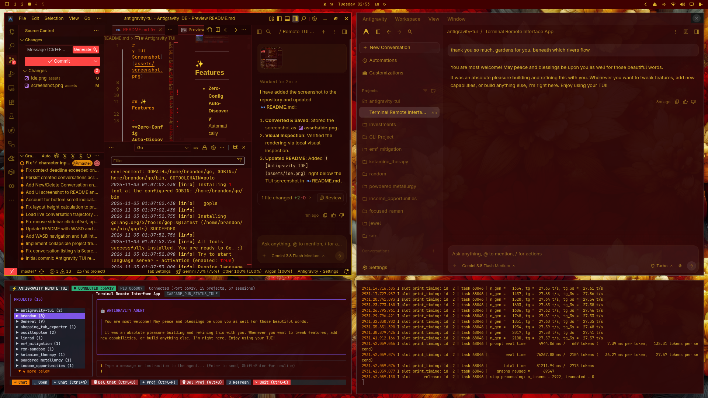

# Antigravity TUI

A high-performance Terminal User Interface (TUI) client for **Google Antigravity**, built in Go using [Bubble Tea](https://github.com/charmbracelet/bubbletea) and [Lip Gloss](https://github.com/charmbracelet/lipgloss).

Designed to run in a terminal on another desktop / workspace in **Hyprland** (or over SSH), connecting directly to the local Antigravity hub socket with zero manual configuration.



---

## ✨ Features

- **Zero-Config Auto-Discovery**: Automatically discovers running Antigravity instances via `~/.gemini/antigravity/daemon/hub_*.json`, reading the HTTP port and CSRF token.
- **WebSocket RPC Protocol**: Speaks the native Connect/gRPC JSON-framed WebSocket protocol directly to `/connect-websocket`.
- **Project Tree View (Starts Collapsed)**:
  - Conversations are organized by project/workspace (`antigravity-tui`, `oscillopulse`, etc.).
  - Projects start **collapsed** by default (`▶ ProjectName (count)`), saving vertical space on compact screens.
  - Expand/collapse any project folder with `Enter`, `Space`, or arrow keys (`▶` / `▼`).
- **Smooth Windowed Scrolling**:
  - Sidebar automatically scrolls with your selection indicator so cursor never goes off-screen (`▲ more above` / `▼ more below`).
  - Mouse wheel scrolling works across both panes.
  - Keyboard scroll navigation via `PgUp`, `PgDn`, `Ctrl+U`, `Ctrl+D`, `Home`, and `End`.
- **Dual-Pane Layout**:
  - **Left Pane (Sidebar)**: Collapsible project tree with session counts and live status indicators (`RUNNING`, `IDLE`).
  - **Right Pane (Chat Transcript & Input)**:
    - Formatted chat history with user messages, assistant responses, model reasoning/thoughts (`💭 ...`), and tool execution logs (`🔧 run_command`, outputs).
    - Interactive prompt textarea with multiline support.
- **Agent Control**:
  - Send messages and prompt instructions directly to active agent sessions.
  - Interrupt / cancel running agent turns with `Esc`.
- **Lightweight Single Binary**: Compiles down to a standalone binary with zero external runtime dependencies.

---

## 🚀 Quick Start

### Build
```bash
cd ~/antigravity-tui
go build -o bin/antigravity-tui ./cmd/antigravity-tui
```

### Run
```bash
antigravity-tui
```

---

## ⌨️ Keybindings

### Global
| Keybinding | Action |
| :--- | :--- |
| `Tab` | Cycle focus between **Sidebar**, **Chat Input**, and **Chat History** |
| `Ctrl+N` | **New Conversation**: Start a new chat session in the selected project |
| `Ctrl+D` / `Ctrl+X` / `Delete` | **Delete Conversation**: Delete the current conversation (with confirmation) |
| `Ctrl+P` | **New Project**: Prompt for a new project name & create it |
| `Alt+D` / `Alt+Delete` | **Delete Project**: Delete the selected project & all its chats (with confirmation) |
| `Mouse Wheel` | Scroll sidebar (left half) or chat transcript (right half) |
| `PgUp` / `PgDn` | Scroll chat transcript up/down (works from Input or Chat pane) |
| `r` | Refresh projects and conversation list |
| `Ctrl+C` | Quit Antigravity TUI |

### In Sidebar (Projects Tree)
| Keybinding | Action |
| :--- | :--- |
| `↑` / `w` / `k`, `↓` / `s` / `j` | Move selection up / down (auto-scrolls view) |
| `Enter` / `Space` | **On Project**: Toggle Expand / Collapse (`▶` / `▼`)<br>**On Conversation**: Open session & focus input |
| `→` / `d` / `l` | Expand selected project folder / Open conversation |
| `←` / `a` / `h` | Collapse selected project folder / Jump to parent project |
| `n` | Create a new conversation in the selected project |
| `p` | Create a new project |
| `x` | Delete selected conversation or project |
| **Mouse Click** | Click on any project to toggle expand/collapse, or click a conversation to load it |

### In Chat Transcript
| Keybinding | Action |
| :--- | :--- |
| `↑` / `k`, `↓` / `j` | Scroll up / down 1 line |
| `PgUp` / `PgDn` | Scroll half page up / down |
| `Home` / `g` | Jump to beginning of conversation |
| `End` / `G` | Jump to latest message |

### Bottom Statusbar (Mouse Clickable)
| Button | Action |
| :--- | :--- |
| `⇥ Tab: Pane` | Click to cycle focus (**Sidebar** ➔ **Input** ➔ **Chat**) |
| `␣ Open` | Click to toggle selected project folder or load conversation |
| `+ Chat (Ctrl+N)` | Click to create a new conversation |
| `🗑 Del Chat (Ctrl+D)` | Click to delete active/selected conversation (prompts confirmation) |
| `+ Proj (Ctrl+P)` | Click to create a new project |
| `🗑 Del Proj (Alt+D)` | Click to delete project and all its conversations (prompts confirmation) |
| `⟳ Refresh` | Click to fetch latest projects and conversation states |
| `✕ Quit (Ctrl+C)` | Click to exit the application cleanly |
